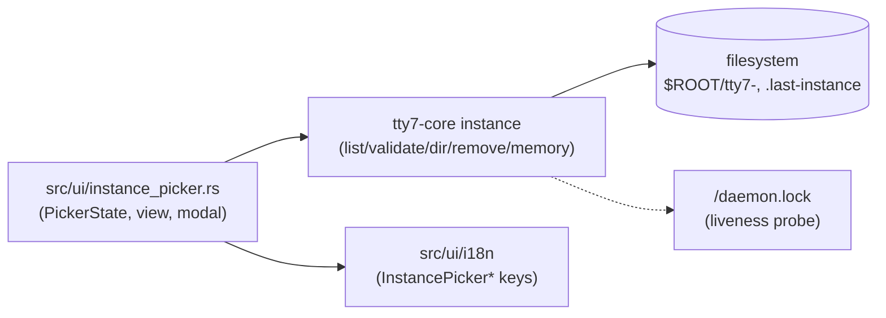

# Architecture Spine — username-selector

## Design Paradigm

Layered, adopted from the existing tree: `tty7-core` holds pure logic (no gpui), `src/ui` holds the gpui view. The picker is a thin skin over the instance module, same as today — the redesign changes the skin's shape (combobox + modal), not the layering.



UI depends on core; core never depends on UI. Nothing bypasses the instance module to touch instance directories.

## Invariants & Rules

### AD-1 — Layered split stays: core pure, view renders [ADOPTED]

- **Binds:** all
- **Prevents:** core importing gpui; the view calling `std::fs::remove_*` (or any direct instance-dir mutation) itself
- **Rule:** All filesystem mutation and name validation live in `tty7-core/src/core/instance.rs`. The picker renders state and calls the module; it owns no fs paths beyond what the module returns.

### AD-2 — `remove_instance` is one core op: validate → probe → unlink

- **Binds:** delete path
- **Prevents:** an untestable delete wired to the live `$HOME`, ad-hoc `remove_dir_all` calls sprouting in UI code, a failed delete that still drops the row or rewrites memory, and probe/remove disagreeing on the directory
- **Rule:** New `remove_instance(name)` (+ `remove_instance_in(root, name)` for tests — one dir, matching the existing `*_in` shape; memory rewrite stays the caller's ordered job per AD-7) in the instance module. It validates the name first (invalid or `default` sentinel is an error, never a path), resolves the directory once, refuses symlinked instance dirs, runs the authoritative liveness probe (AD-3) inside the op, then unlinks. Live seat → refusal error, never unlink. The pre-confirm probe behind the report is advisory only; this in-op probe is authoritative (residual probe→unlink window documented, not closed). On `Err` the modal stays open with the error line: no row removal, no memory rewrite.

### AD-3 — Delete is gated on a dir-scoped tri-state probe; refusal ships a report

- **Binds:** delete path
- **Prevents:** deleting an instance whose server is still running, a bare "are you sure" with no actionable next step, and probe errors failing open into a delete
- **Rule:** Before `remove_instance`, probe `<instance-dir>/daemon.lock` with a shared non-blocking lock via a dir-scoped helper living in the instance module (`holder_pid_in`-shaped; `config_path("daemon.lock")` resolves against the global pinned dir and cannot address another instance — the singleton is untouched). Outcome is tri-state: Live (holder pid) → refuse the delete and render the modal-inline report (instance name, config dir path, pid labelled advisory/unverified, stop command `tty7 --as <name> server stop`, and the `rm -rf <dir>` command for after the stop; the modal offers no kill action); Free → proceed; Unknown (non-unix where the probe does not exist, lock errors such as NFS `ENOTSUP`, or unopenable lock paths) → warn and require a second explicit confirm before proceeding. A held lock with an unreadable pid record is Live with advisory `None`, never Unknown — the flock outcome is authoritative for liveness while the pid is advisory, and routing it to Unknown would let a double-confirm delete a live server. The user stops the server themselves; the picker never kills it.

### AD-4 — Last-used time comes from the instance dir mtime [ADOPTED]

- **Binds:** row meta display
- **Prevents:** a new bookkeeping file/format/migration for v1
- **Rule:** `metadata().modified()` on `tty7-<name>`; the listing snapshots `(name, mtime)` pairs once per open/refresh and orders mtime-descending with name-ascending tie-break — never re-read mid-render. Render relative when available, omit the meta when the filesystem cannot supply it. No new state file. mtime skew (restore/copy) and top-level-only churn are accepted for v1.

### AD-5 — Filter text has one owner; the rest is derived

- **Binds:** combobox state
- **Prevents:** two copies of the query drifting (InputState vs PickerState vs core), and the old typed-wins `confirm` resurfacing through the Enter path
- **Rule:** `InputState` owns the text. `PickerState` derives the filtered list, highlight index, and dropdown/modal flags from `(names, query)` on each change. Core never sees the query — it receives resolved names only. Enter confirms the highlighted row only: a valid-but-unlisted typed name requires the explicit create-button click — the view never calls `ensure_dir` from the Enter path. `Esc` always closes the topmost layer first (modal → dropdown → window), never skipping; modal stacks never exceed one deep. Full keyboard/focus/a11y contract (arrows wrap, × stop-propagation, focus trap + return, aria-live counts) is owned by `EXPERIENCE.md` per AD-9 — not restated here.

### AD-6 — `validate_name` is the single validation authority

- **Binds:** create + filter-validity paths
- **Prevents:** the view re-implementing `[a-z0-9-]` and diverging on edge cases (sentinel, leading `-`)
- **Rule:** The view calls `instance::validate_name` for button enablement and the invalid line; it never encodes the rule itself.

### AD-7 — Memory follows the focused row, written once after success

- **Binds:** `.last-instance` writes
- **Prevents:** a dangling preselect pointing at a deleted instance, and two memory writers racing last-writer-wins
- **Rule:** Producers are exactly two: the confirm-selection path (`apply_selection`) and the post-delete focus fallback; the pre-existing `remember_current()` explicit-config path is untouched and out of this scope. `write_last_in` enforces name shape itself (refuses invalid/sentinel) so the guarantee does not rest on call-site discipline. The post-delete rewrite runs strictly after `remove_instance` returns `Ok`, with the focused row's value (next row, or `DEFAULT_SENTINEL` when focus lands on Default). Never write unvalidated or deleted names. (Supersedes `EXPERIENCE.md`'s `[ASSUMPTION]` that core rewrites memory — flagged for a UX Update pass.)

### AD-8 — New strings join the `InstancePicker*` family in zh+en

- **Binds:** combobox/create/modal/report strings
- **Prevents:** hardcoded strings and single-locale keys
- **Rule:** Every new user-visible string (create button, no-match hint, modal title/body/confirm, report lines, delete-error) gets an `L10nKey::InstancePicker*` entry with `en.rs`, `zh.rs`, `ja.rs`, and `ru.rs` arms in the same change — the repo ships four locales, and a two-locale change is incomplete.

### AD-9 — UX companion spines bind the surface; this spine never duplicates them

- **Binds:** all visual and behavioral detail (colors, type, spacing, radii, viewport cap, keyboard micro-rules, a11y floor, voice)
- **Prevents:** two sources of truth for the surface (values drifting between `DESIGN.md` and this spine), and builders inventing tokens the UX spines already fixed
- **Rule:** `../ux-username-selector/DESIGN.md` and `EXPERIENCE.md` are binding companions for everything they specify — including the 6–8-row viewport cap, fixed compact window, green/red token values, and the keyboard/focus/a11y contract. This spine restates none of those values. On any conflict between this spine's structural rules (AD-1–AD-8) and the companions, this spine wins; on anything the companions specify that this spine is silent about, the companions win over builder judgment and over `mockups/key-picker.html`.

## Consistency Conventions

| Concern | Convention |
|---|---|
| Naming | `remove_instance` / `remove_instance_in(root, name)` mirror `read_last` / `read_last_in`; liveness helper is `holder_pid_in`-shaped and lives in the instance module (singleton untouched) |
| Data & formats | Instance name is `String` post-`validate_name`; memory values are `default` sentinel or a valid name; errors are `io::Result`, UI-mapped, never panics on fs failure |
| State & mutation | Picker mutations flow one way: input event → derived `PickerState` → core call → memory write; no core call without a prior user confirm (select/create/delete-confirm) |
| Logging | Refused deletes (live server) and failed removes log at warn with instance name + dir; successful deletes log at info |
| Config | No new config keys for this slice; root resolution reuses `default_root()` |

## Stack

| Name | Version |
|---|---|
| Rust | edition 2024 |
| gpui + gpui-component | workspace pin (zed rev / tty7 branch) |

## Structural Seed

```text
crates/tty7-core/src/core/instance.rs  # list/validate/dir_for/ensure/remove/memory + mtime helper
crates/tty7-core/src/daemon/singleton.rs  # seat primitive; dir-scoped probe alongside or in instance.rs
src/ui/instance_picker.rs  # PickerState (derived filter/highlight/modal), combobox view, report modal
src/ui/i18n/{zh,en}.rs  # InstancePicker* keys, both locales together
```

## Capability → Architecture Map

| Capability / Area | Lives in | Governed by |
|---|---|---|
| Filter + highlight + dropdown | `instance_picker.rs` PickerState | AD-5, AD-6 |
| Explicit create | picker view → `ensure_dir`/`dir_for` | AD-1, AD-6, AD-7, AD-8 |
| Delete + liveness report | picker modal → probe → `remove_instance` | AD-2, AD-3, AD-8 |
| Preselect + memory fallback | `read_last` / `write_last` | AD-7 |
| Last-used meta | mtime helper in instance module | AD-4 |
| All strings | i18n keys | AD-8 |
| Surface detail (tokens, viewport, keyboard, a11y) | UX companion spines | AD-9 |

## Deferred

- Multi-machine server inventory and file-exported delete report (modal-inline only for v1; user asked "if possible" — revisit when remote-instance scope exists)
- Pinyin/fuzzy filtering (substring only per UX `[ASSUMPTION]`)
- Trash-vs-permanent delete (permanent `remove_dir_all` semantics for v1)
- mtime-skew hardening if last-used ordering ever drives behavior beyond display
