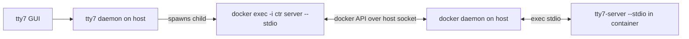
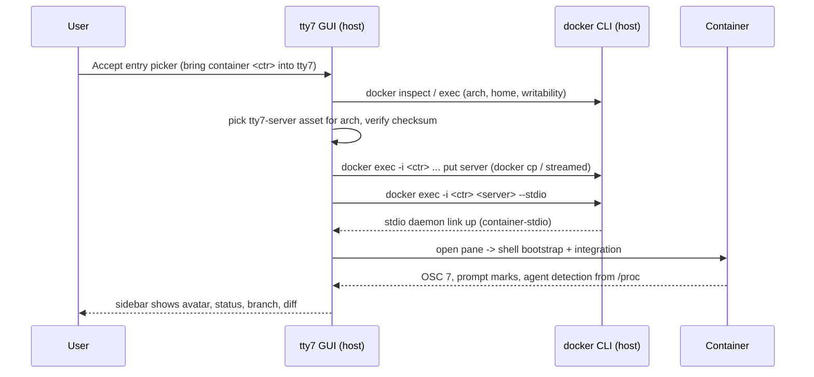
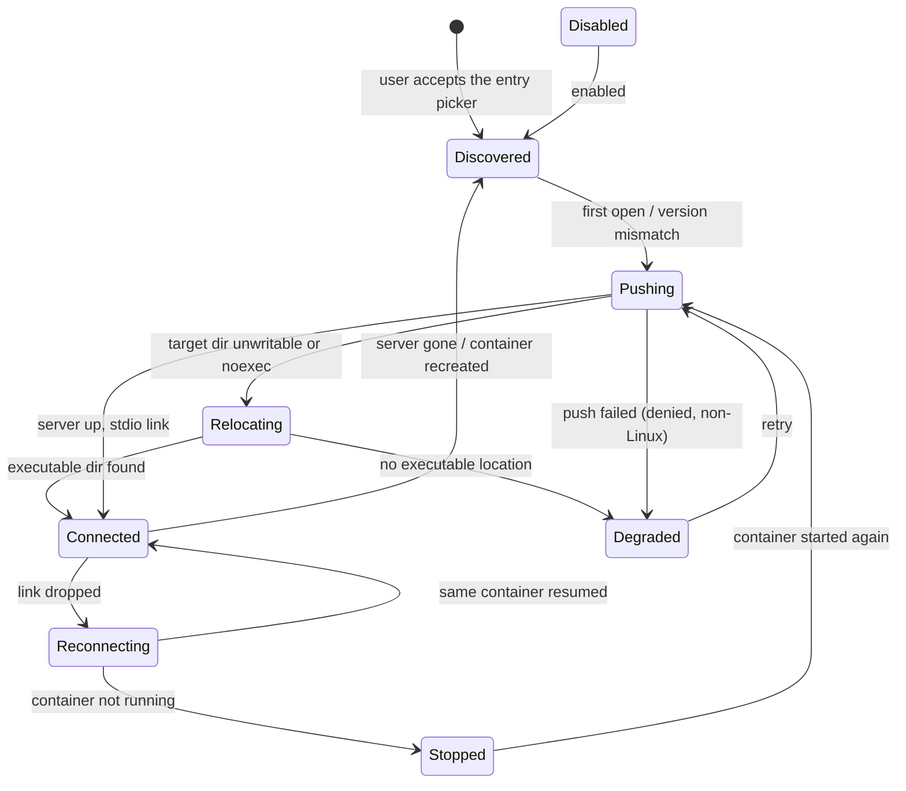

# Container host — design (companion to SPEC.md)

Load-bearing because it names the seams the implementation must dock into. Intent and
success live in `SPEC.md`; this file holds the multi-item integration detail, the
sequence, the lifecycle, and the degradation matrix.

## Model

A container is a **remote host**. tty7 installs its static `tty7-server` into the
container and speaks its existing daemon protocol over `docker exec -i <ctr> …
tty7-server --stdio`. Once that link is up, the container pane is an ordinary remote
pane: shell integration, in-container agent detection, cwd, git, files, and diffs all
come from the existing remote path. Nothing downstream of the transport is container-aware.

Consequence: the host-side runtime argv is irrelevant to the sidebar (CAP-3) and the
mount shape is irrelevant to git (CAP-4), because detection and git run *inside* the
container.

The pushed server lands on the same POSIX path the SSH/WSL installers use —
`$HOME/.local/share/tty7/bin/tty7-server-<dialect>` (same dir chain, `700`/`755` modes).
When that location is unwritable or noexec, tty7 relocates the server to an executable
writable directory and retries, degrading (with a stated reason) only when no executable
location exists.

A container becomes a target only by explicit user consent through the entry picker;
nothing enumerates or adopts containers in the background.

## Transport is host IPC, not the container network

The daemon protocol rides the `docker exec -i <ctr> <server> --stdio` process's
stdin/stdout, carried by the Docker API over the **host's** docker socket (unix socket
or npipe). Containers need no network route back to the GUI and expose no listener.

Therefore `--network bridge|host|none` is immaterial and a `--network none` container
works unchanged. The only network dependency is host ↔ docker-daemon, i.e. the user's
existing docker access; a daemon that is itself remote (`DOCKER_HOST` over ssh/tcp) is
out of scope for v1 (see SPEC constraints).

The docker socket is used by the **host-side** `docker` CLI and is never mounted into
the container. There is no new volume, flag, or start-command change: tty7 attaches to
an already-running container.

## WSL-hosted runtimes

The runtime CLI need not live on the Windows host. Two supported shapes:

- **Docker Desktop WSL2 backend** — `docker` on the Windows host, daemon in the
  `docker-desktop` distro. `docker exec -i … --stdio` runs from Windows and the
  container is Linux; nothing WSL-specific is needed beyond reading the runtime from
  the Windows side.
- **Docker installed inside a WSL distro** — the invocation is wrapped as
  `wsl.exe -d <distro> --exec docker exec -i <ctr> <server> --stdio`, reusing the
  existing `wsl_args` / `WslRemoteOps` plumbing; the stdio link spans
  Windows → distro → container, and the wrapping distro is part of the target identity.

The container itself is always Linux, so CAP-2 through CAP-5 are unchanged; only how
the runtime is reached, and the target's connection key, differ.

## Integration points

| Need | Existing asset | New work |
|---|---|---|
| Install server in the far namespace | `install/wsl.rs` (`WslRemoteOps` implementing `RemoteOps`) as the non-SSH template; `install/{asset,download,checksums}.rs` for arch + `tty7-server-linux-{x86_64,aarch64}-musl` | `install/container.rs`: `ContainerRemoteOps` implementing `RemoteOps` over `docker exec` / `docker cp` (home/run/stat/put/rename/…), arch via `uname -m` |
| Carry the daemon protocol | `RemoteTarget` (`core/session.rs`), `RemoteLink::local_stdio` (`daemon/remote_link.rs`), `RouteTarget` (`daemon/router.rs`) | A `RemoteTarget::Container` variant + `RouteTarget::Container` / link label `container-stdio`; transport = `docker exec -i <ctr> <server> --stdio` |
| Shell integration, cwd, completion, history | `remote::bootstrap_command` path (`daemon/ssh/mod.rs`) | reuse unchanged |
| Agent avatar + status | far daemon foreground detection (`daemon/pane.rs` → `/proc` inside the container) | reuse unchanged; hooks land via Settings → Integrations machine chips |
| Branch, diff, file tree, panels | remote `Host` stack (`host/`), right panel, file tree, diff overlay | reuse unchanged |
| Target lifecycle + reconnect | SSH/WSL connect + reconnect UX | container "not running" state; reuse-on-reopen |

## Sequence (first open)

## Lifecycle

`Disabled`/`Stopped` surface where an added target is listed; `Degraded` carries the
stated reason (CAP-6).

## Degradation matrix

| Condition | Behavior |
|---|---|
| `docker` CLI absent / not on PATH | Container host unavailable; reason stated; host-side panes unaffected |
| Container not running | Non-connected state; no push attempted until running |
| `docker exec` denied | Degraded with denied reason; pane not opened as a container pane |
| Non-Linux container / Windows container | Degraded; out of scope for v1 |
| Only noexec storage writable | Relocate the server to an executable writable directory and retry; degrade with reason only if none exists |
| `$HOME` missing / not writable | Same relocation to a writable, executable directory (CAP-2); degrade only if none exists |
| Container recreated (`docker run` again) | Treated as a new target; re-push (CAP-2 reuse is per running container identity) |
| podman / nerdctl | Best-effort: same command shapes; not required for v1 |

## Path semantics

Container paths are far-host paths, which the remote `Host` and the panels already
distinguish from local paths — so no translation layer is needed and the three mount
shapes (bind same path, bind different path, in-container clone) behave uniformly.
